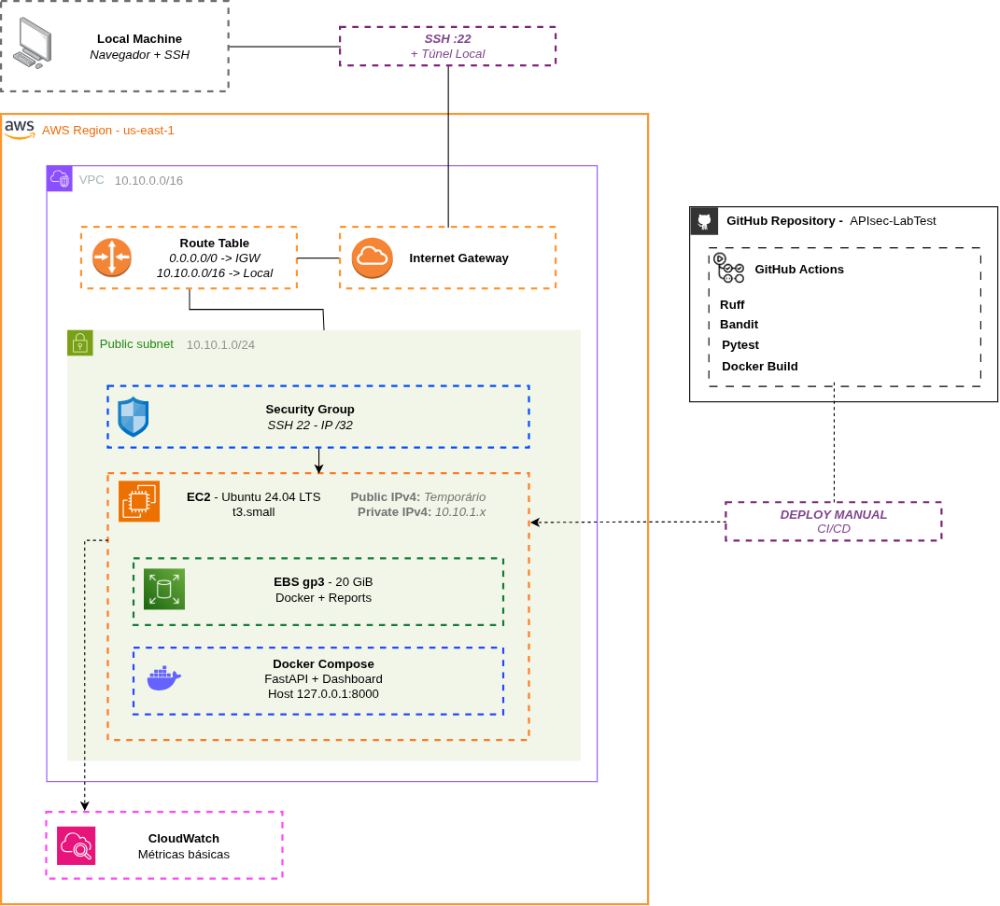

# APIsec

Laboratório de segurança de APIs desenvolvido com FastAPI. Reproduz falhas de autorização em cenários controlados, compara o comportamento vulnerável com o protegido e gera evidências em Markdown e JSON.

O projeto usa dados fictícios e foi feito para estudo, testes de regressão e demonstração técnica — não é um scanner de aplicações externas.

## Cenários

| Cenário | Simulação | Sem proteção | Com proteção |
| --- | --- | --- | --- |
| **BOLA** · OWASP API1:2023 | Alice consulta um documento de Bob | `200` | `404` |
| **BFLA** · OWASP API5:2023 | Alice tenta excluir um documento sem permissão administrativa | `204` | `403` |
| **BOPLA** · OWASP API3:2023 | Alice consulta um documento que contém uma propriedade interna | Campo `internal_notes` exposto | Campo omitido |

Cada execução cria instâncias isoladas da API vulnerável e da API protegida por meio do `TestClient`. A aplicação vulnerável não é montada como serviço acessível pela rede; os testes não alteram os documentos da aplicação principal.

A interface permite escolher um cenário, executar a simulação, comparar as respostas HTTP e baixar o relatório. Também há uma CLI para execução sem navegador.

## Executar

Requisitos: Docker Engine com Compose v2 ou Python 3.13.

**Com Docker Compose** (recomendado):

```bash
docker compose up -d --build --wait
docker compose ps
```

Acesse **http://127.0.0.1:8000**. Se a porta estiver ocupada:

```bash
APISEC_PORT=8001 docker compose up -d --build --wait
```

**Com Python:**

```bash
python -m venv .venv
source .venv/bin/activate
python -m pip install -r requirements-dev.txt
python -m uvicorn app.main:app --host 127.0.0.1 --port 8000
```

O health check está em `GET /health`; a documentação interativa da API, em `/docs`.

Para encerrar o container sem apagar o volume dos relatórios: `docker compose down`. Não use `down -v` se precisar preservar os arquivos.

## Testes e relatórios

Com o ambiente Python e as dependências de desenvolvimento instaladas:

```bash
python -m pytest -v --junitxml=reports/junit.xml
python -m ruff check .
python -m ruff format --check .
python -m bandit -r app lab
python -m lab.cli --output-dir reports
```

Para simular apenas um cenário, use `python -m lab.cli --scenario bopla --output-dir reports`.

Os relatórios incluem a referência OWASP, a operação HTTP, as respostas comparadas, o impacto simulado e a mitigação. Valores internos são ocultados e cabeçalhos de autenticação não são incluídos. São evidências de um laboratório, não achados em sistemas reais.

Os resultados ficam em `reports/`, fora do Git. Há limite de **500 pares JSON/Markdown** por diretório, sem exclusão automática. Ao atingir o limite, novas gravações são recusadas até que os arquivos sejam arquivados ou removidos manualmente. Para copiar os arquivos de um container:

```bash
mkdir -p reports
docker compose cp apisec:/app/reports/. ./reports
```

O dashboard mostra o resultado da última execução registrado em `reports/junit.xml`, quando disponível; ele não roda o Pytest pelo navegador.

### Integração contínua

O [GitHub Actions](.github/workflows/security-tests.yml) executa Ruff, Bandit, Pytest, geração de evidências, validação do Compose e build da imagem Docker. Os relatórios são publicados como artefatos da execução por 14 dias. **A pipeline não faz deploy.**

## Arquitetura e limites

- **Backend e interface:** FastAPI, Jinja2 e JavaScript simples.
- **Autenticação:** tokens fixos e públicos para Alice, Bob e Admin, exclusivamente para demonstração.
- **Autorização:** checagem de propriedade do documento, operações administrativas e seleção dos campos retornados.
- **Execução:** dados em memória e um único processo de aplicação; sem banco de dados.
- **Container:** usuário não root, filesystem somente leitura, volume para relatórios, health check, limites de recursos e publicação apenas em `127.0.0.1`.

A arquitetura original da API também está documentada em [docs/Arquitetura-APIsec.png](docs/Arquitetura-APIsec.png).

### Topologia AWS proposta

A topologia abaixo registra um possível ambiente de laboratório: VPC com subnet pública, EC2, EBS, Docker Compose, Security Group restrito a SSH, acesso ao dashboard por túnel SSH e métricas básicas no CloudWatch. O GitHub Actions permanece responsável somente pela CI.

**Esta infraestrutura foi projetada, mas não provisionada nem testada na AWS.** A aplicação não foi publicada na internet.



## Próximo estudo

[Modelar a topologia AWS em Terraform — Issue #1](https://github.com/CarlossgLuz/APIsec-LabTest/issues/1): praticar HCL e Infrastructure as Code, descrever os recursos do diagrama e validar os arquivos localmente, sem criar recursos cloud nesta etapa.

## Referências

[OWASP API Security Top 10 (2023)](https://owasp.org/API-Security/editions/2023/en/0x00-header/) · [FastAPI](https://fastapi.tiangolo.com/) · [Docker Compose](https://docs.docker.com/compose/)
